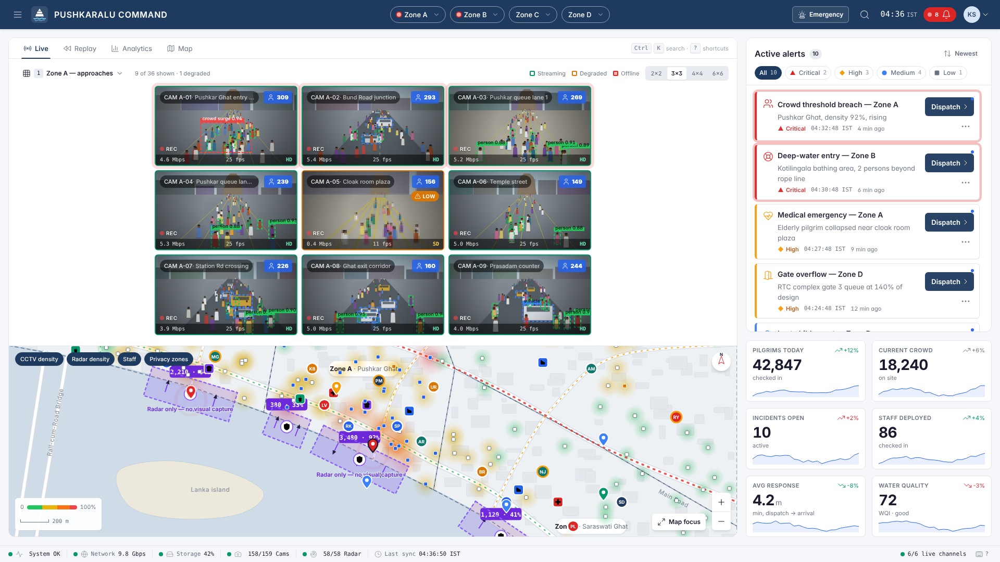
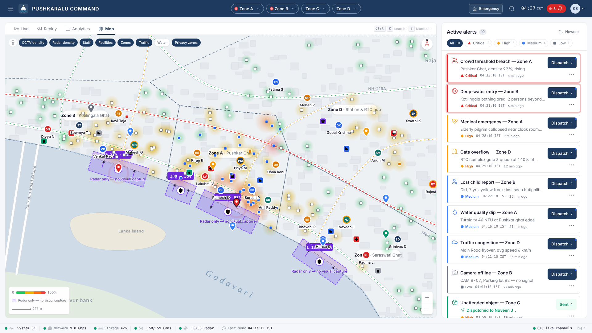
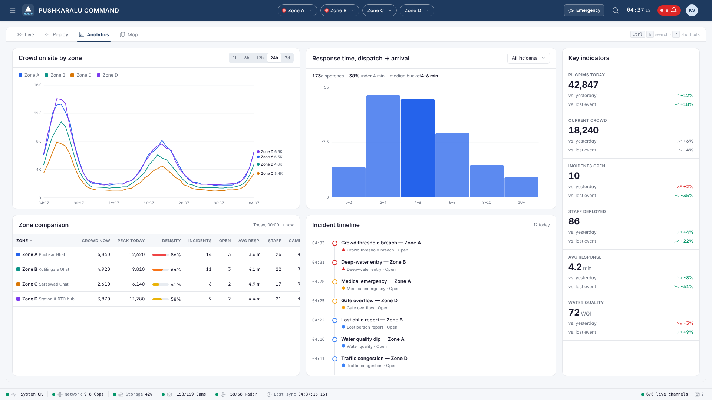
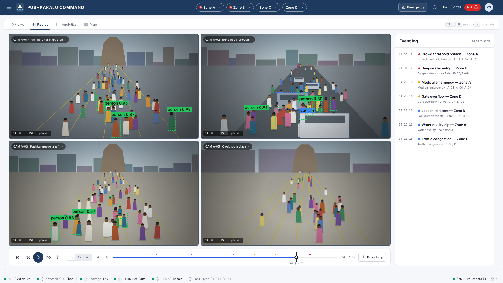
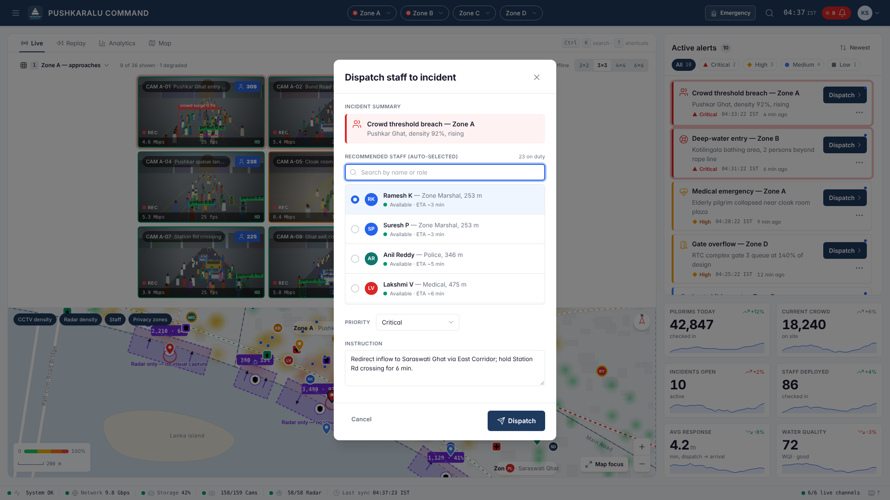
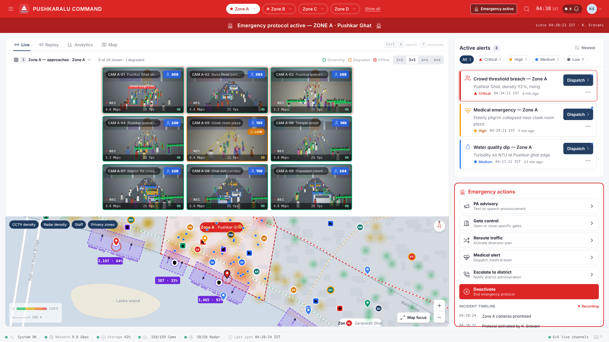
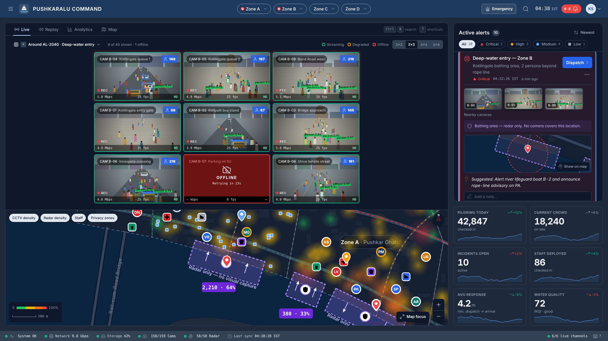
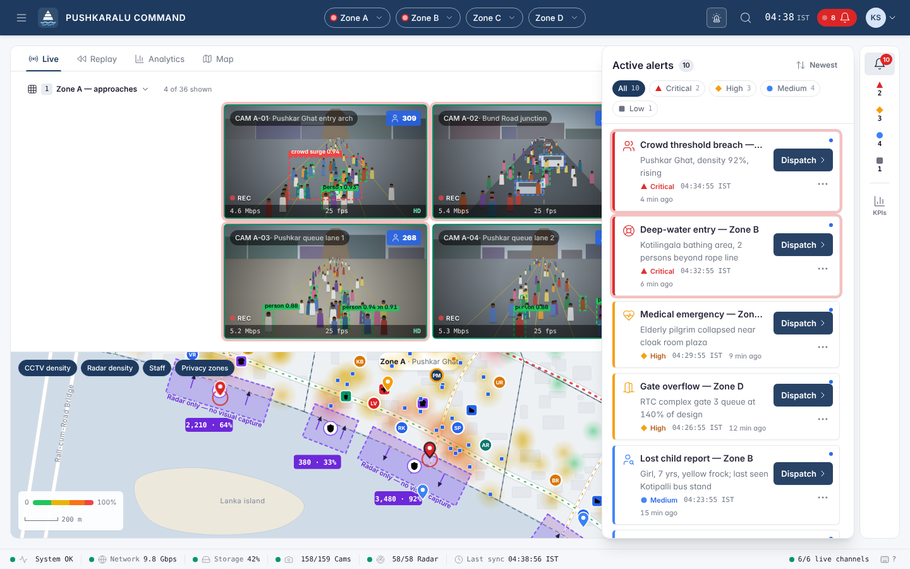
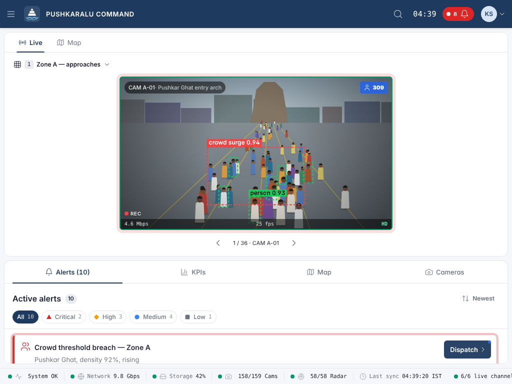

# Pushkaralu Command — RTIH_UI_01

Command-centre surveillance dashboard for **AP Godavari Pushkaralu 2027, Rajamahendravaram**, built to the
*RTIH Godavari Pushkaralu 2027 — Surveillance Dashboard UI Brief* (v1.0) and its **Godavari Command** design system.



[](https://vercel.com/new/clone?repository-url=https%3A%2F%2Fgithub.com%2Fdhruvv2112-coder%2FRTIH_UI_01&project-name=rtih-ui-01&repository-name=RTIH_UI_01)

- **Figma (design system + screens):** https://www.figma.com/design/E9mb4OwUnAc0UUkM5w2lVU
  — pages: Cover · Foundations (colour variables with Light/Night modes, text & effect styles) · Components
  (Button, Chip, Status dot, Tab, Zone chip, Toast, Emergency action, Alert card, Camera card, KPI card,
  Staff option, GIS map) · Screens — Desktop LG (Live Command, Night theme, Map focus) · States & Modals
  (Dispatch dialog, Emergency protocol) · Responsive (Tablet, Phone redirect, breakpoints)

> **Status:** interactive UI prototype. Every data source in brief §10 (S1/S2/S3 WebSockets, REST, HLS) is
> simulated in the browser so operators and reviewers can try every flow. Cameras, staff, alerts and
> counts are illustrative, not real.

## Run it

No build step and no dependencies: it's plain ES modules plus CSS custom properties, so it runs on an air-gapped command-centre LAN.

```bash
npm run dev          # serves on http://localhost:4173 (or any static server)
npm run check        # CI check: modules parse, imports resolve, assets exist
```

Deploy: import this repo in Vercel (framework **Other**, no build command, output `.`). `vercel.json` sets
security headers and caching.

## What's covered (brief → implementation)

| Brief | Implemented |
|---|---|
| §1 Principles P1–P6 | 2-second scan (critical alerts pulse + chime + red zone chip), 30-second **Undo** on acknowledge/resolve/dispatch, muted resting states, shape + colour + label status, progressive disclosure, full keyboard map |
| §1.3 Privacy | Bathing ghats render as **radar-only privacy zones** (purple dashed, shield, "Radar only — no visual capture"); no camera is ever placed inside them; radar alerts say so explicitly |
| §2 Tokens | `src/styles/tokens.css` — every colour, type, spacing, shadow, radius, motion and z-index token; light + dark (night shift) |
| §3 Shell | 56 px header (zone chips with menus, expanding search, IST clock, alert badge, user menu), 32 px status footer with thresholds |
| §4 Layouts | **Live** (grid 60% / map 40% + alert queue + KPI strip), **Map focus** (Space), **Analytics**, **Replay** |
| §5.1 Camera card | 16:9, name pill, person-count badge, AI boxes (person/vehicle/anomaly), REC, status bar; streaming / degraded / offline / selected / hover / enlarged with playback, screenshot, digital zoom, PTZ |
| §5.2 Alert card | priority stripe, collapsed/expanded (nearby cams, mini-map with 200 m radius, suggestion, notes, staff nearby), unread / read / acknowledged / dispatched / resolved, filters, sort, empty state |
| §5.3 KPI strip | 6 KPIs, trend arrow coloured by meaning, 24-point sparklines, live drift |
| §5.4 GIS map | offline SVG cartography of the riverfront: CCTV heatmap, radar density, staff, facilities, zones, traffic flow, water sensors, privacy zones; zone sheet, popups, right-click menu, **Shift-drag to select cameras**, pan/zoom/fit |
| §5.6 Dispatch | staff sorted by distance, auto-select nearest available, search, priority, instruction, loading state, recall |
| §5.7 Emergency | red header + flashing banner (settles after 10 s), actions panel (PA, gates, reroute, medical, escalate), auto-recording timeline, 60 s alarm, confirm to deactivate |
| §5.8 Toasts | top-right stack of 3, auto-dismiss 5 s / 8 s / manual, progress bar, pause on hover |
| §6 Keyboard | Space, 1–9, A, D, Esc, F, R, Enter, arrows, Ctrl+K palette (fuzzy), N, ?, Alt+1–4 |
| §7 Responsive | XL ≥3840 6×6 · LG 3×3 · MD 2×2 with icon rail + drawer · SM tablet single camera + tabs · XS redirect to Staff app |
| §8–9 States & motion | button/input/card states; alert arrival, camera enlarge clip-path, radar pulse, emergency flash, toasts, dispatch dots; `prefers-reduced-motion` respected |

## Structure

```
index.html
src/styles/   tokens · base · shell · components · views · responsive
src/js/       app (routing, keyboard, simulation) · store · data · util · icons
              shell (header/footer) · cameras · camera-sim · map · alerts · kpi
              dispatch · emergency · palette · analytics · replay · ui (toast/modal/menu/audio)
docs/screenshots/
```

The module boundaries mirror brief §12.1 so each piece can be ported to the React + TypeScript + Zustand target stack
one at a time. Simulated feeds live in `data.js` and `camera-sim.js`; swap them for the §10 WebSocket/REST clients.

## Screens

| | |
|---|---|
|  |  |
|  |  |
|  |  |
|  |  |

## Notes for production

- Self-host Inter and JetBrains Mono (Google Fonts is linked for the demo; system fallbacks apply offline).
- Replace the SVG base map with Mapbox GL offline tiles; layer semantics and colours carry over unchanged.
- Theme preference uses `sessionStorage` only; nothing is written to `localStorage`, per brief §16.

## Pushkaralu Suite: all three apps on one local server

`suite/` runs this dashboard, the [Field app (RTIH_UI_02)](https://github.com/dhruvv2112-coder/RTIH_UI_02) and the [Pilgrim app (RTIH_UI_03)](https://github.com/dhruvv2112-coder/RTIH_UI_03) from one zero-dependency Node server (port 8080) with a live event hub:

- Pilgrim SOS → critical alert here → **Dispatch** → INCOMING DISPATCH on the field app → accept / decline / note / complete flow back here and to the pilgrim's SOS screen.
- Field reports and staff SOS create alerts; the emergency protocol reaches both phone apps; the field app's offline mode queues events until reconnect.

```bash
# clone RTIH_UI_01, RTIH_UI_02 and RTIH_UI_03 side by side, then:
node suite/build.mjs --rebuild     # → dist/Pushkaralu-Suite
cd dist/Pushkaralu-Suite && node server.mjs --open   # or start.bat on Windows
```

The assembled folder needs only Node.js 18+; `start.bat` installs Node with winget if it is missing. Without the suite server (e.g. on Vercel) the live link stays off and the apps use their built-in simulations. API: `GET /api/health`, `GET /api/stream` (SSE), `GET|POST /api/events`, `POST /api/reset`.
